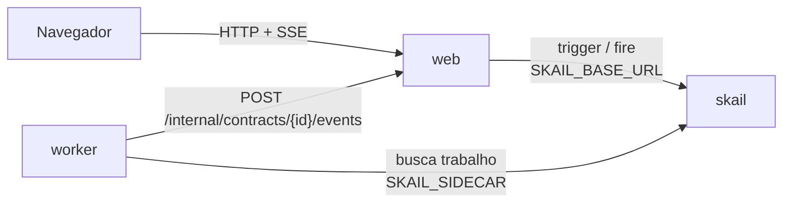

# skail document signing (Node / TypeScript + React)

[English](README.md)

Uma function do skail manda um contrato para o Jurídico e o Financeiro ao mesmo tempo e espera as duas assinaturas, em qualquer ordem, até um prazo. A segunda assinatura arquiva o contrato. Uma recusa cancela na hora, sem esperar a outra área, e o prazo vencido expira o contrato; nos dois casos a assinatura já dada é revogada e o pedido pendente é retirado. O prazo é de 2 minutos nesta demo e de dias num contrato de verdade, com o mesmo código. Uma página React envia o contrato e tem os botões **Sign** e **Refuse** para cada área.

A demo mostra três tópicos da [documentação do skail](https://docs.skail.dev):

- [eventos externos](https://docs.skail.dev/construa/conceitos/eventos-externos-e-correlacao): um evento por área, correlacionado pelo id do contrato;
- o padrão de [espera com prazo](https://docs.skail.dev/construa/como-fazer/esperar-um-evento-com-prazo): as assinaturas ou o prazo, o que vier primeiro;
- [human-in-the-loop](https://docs.skail.dev/construa/como-fazer/padroes-e-antipadroes/human-in-the-loop), com duas áreas decidindo em paralelo.

## Como funciona



- **worker** (`apps/worker`): a function `SignContract(contractId, title, deadlineSeconds)` e os commands dela. O `RequestSignature` pede a assinatura a uma área; `ArchiveContract`, `CancelContract` e `ExpireContract` encerram o contrato; o `ReportStatus` avisa a página do andamento da execução. Os commands delegam para o `ContractOperations`, então a lógica deles é testada sem o skail.
- **web** (`apps/web`): API e arquivos estáticos. Inicia a execução (trigger), registra a decisão de cada área e manda para a execução (fire), guarda o estado em memória e transmite para a página (SSE).
- **frontend** (`apps/frontend`): a página, em React 18, Vite e TypeScript.
- **contracts** (`apps/contracts`): tipos, constantes e regras puras usados pelos outros três. Ele também entra no bundle do skail, por isso não importa módulos de I/O do Node.

A function só orquestra e deixa o I/O para os commands. Ela cria as duas esperas e o prazo uma vez só e usa o mesmo prazo nos dois `whenAny`, então as duas áreas dividem um prazo único. Em TypeScript, o `whenAny` devolve o valor de quem terminou primeiro, e um delay que vence devolve `undefined` (ver [SDKs e linguagens](https://docs.skail.dev/referencia/sdk-typescript-e-outras-linguagens)). O trecho abaixo é uma versão simplificada do [`contract-functions.ts`](apps/worker/src/contract-functions.ts), que também avisa a página de cada etapa:

```ts
await this.RequestSignature(contractId, title, Areas.legal);
await this.RequestSignature(contractId, title, Areas.finance);
const legal = Skail.waitForEvent<Signature>(Events.legalSignature, contractId);
const finance = Skail.waitForEvent<Signature>(Events.financeSignature, contractId);
const deadline = Skail.delaySeconds(deadlineSeconds);

const first = await Skail.whenAny([legal, finance, deadline]);
if (!isSignature(first)) return await this.ExpireContract(contractId, null);
if (!first.signed) return await this.CancelContract(contractId, first, false);

const second = await Skail.whenAny([first.area === Areas.legal ? finance : legal, deadline]);
if (!isSignature(second)) return await this.ExpireContract(contractId, first);
if (!second.signed) return await this.CancelContract(contractId, second, true);

return await this.ArchiveContract(contractId, first, second);
```

O `isSignature` separa a assinatura do `undefined` do prazo pelo formato do objeto. O web preenche a `area` a partir da requisição validada, então a function sabe qual área respondeu primeiro.

O `CancelContract` e o `ExpireContract` são a compensação: a assinatura já dada é revogada e o pedido pendente é retirado. Os dois são commands, então se o worker parar no meio, a execução continua a partir deles sem pedir de novo às áreas.

## Os caminhos

A página tem o botão **Send for signature** e um card por área, com **Sign** e **Refuse**. O prazo é de 2 minutos.

| O que você faz | O que acontece | Resultado |
|---|---|---|
| **Sign** como Finance, depois como Legal | arquivado quando chega a segunda assinatura, em qualquer ordem | **Archived**, com uma referência `ARC-…` |
| **Refuse** como Legal | cancelado na hora, e o pedido ao Financeiro é retirado | **Cancelled** |
| **Sign** como Legal, depois **Refuse** como Finance | cancelado, e a assinatura do Jurídico é revogada | **Cancelled** |
| **Sign** como Finance e mais nada por 2 minutos | o prazo expira o contrato: a assinatura do Financeiro é revogada e o pedido ao Jurídico é retirado | **Expired** |
| nada por 2 minutos | os dois pedidos são retirados | **Expired** |

Uma segunda decisão da mesma área, ou uma decisão depois do fim, recebe `409`. A primeira decisão vale, e nenhum segundo evento é enviado. A contagem regressiva na página é só visual: o prazo de verdade é o delay durável no skail, que não segura thread nem processo.

## Como conecta ao skail

| Serviço | Variável | Para quê |
|---|---|---|
| worker | `SKAIL_SIDECAR` | Conecta a function ao seu environment e recebe o trabalho dela. |
| web | `SKAIL_BASE_URL` | Inicia execuções e envia as assinaturas pela API HTTP do skail. |

Os dois usam os mesmos `SKAIL_WORKLOAD`, `SKAIL_NAMESPACE` e `SKAIL_KEY`. O web faz duas chamadas:

```http
POST {SKAIL_BASE_URL}/api/v1/trigger/{nome}/{versao}/SignContract/{contractId}
["{contractId}", "Service agreement", 120]

POST {SKAIL_BASE_URL}/api/v1/fire/LEGAL_SIGNATURE/{contractId}
{"area": "legal", "signed": true, "by": "Ana", "reason": null, "at": "2026-11-04T10:00:00.000Z"}
```

O nome do evento vem da área: `LEGAL_SIGNATURE` ou `FINANCE_SIGNATURE`. `{nome}` e `{versao}` vêm de `SKAIL_WORKLOAD` (`nome:versao`). Cada chamada manda a chave em `skail-key` e em `Authorization: Bearer`, mais o header `Skail-namespace`, como descrito em [autenticação](https://docs.skail.dev/referencia/api-http/autenticacao). `429`, `5xx` e erros de rede são repetidos com o mesmo id do contrato. `401` e `403` não são repetidos: confira `SKAIL_KEY` e `SKAIL_NAMESPACE`.

O último número do trigger é o prazo, em segundos. Ele é argumento da function, então entra no histórico da execução e fica fixo para aquela execução. O web lê o prazo de `SIGNATURE_DEADLINE_SECONDS` (120 por padrão); use `604800` para 7 dias.

O navegador nunca chama o skail. Ele só fala com o web, então a chave fica no servidor.

## Requisitos

- Node 20, 22 ou 24 e pnpm 10 (`npm i -g pnpm@10.34.7`)
- podman ou docker
- PowerShell 7+ (`pwsh`), só se você usar o `scripts/run.ps1` em vez do `scripts/run.sh`
- Um environment do skail com o workload de `SKAIL_WORKLOAD` cadastrado (`documentsigning:v1.0.0` por padrão). O [Quickstart](https://docs.skail.dev/comece-aqui/quickstart) mostra como pedir a conta, criar o environment e cadastrar o workload.
- Acesso ao registro público do npm, de onde vêm `@skail/runtime`, `@skail/testing` (2.0.1-rc1) e `@skail/build` (2.0.0).
- Um navegador atual (Chrome/Edge 111+, Firefox 113+, Safari 16.2+). A página usa Server-Sent Events e `color-mix()` do CSS.

## Configurar

```bash
cp .env.example .env     # o .env guarda a chave e é ignorado pelo git
```

Preencha `SKAIL_WORKLOAD` (exatamente como está cadastrado no portal), `SKAIL_NAMESPACE`, `SKAIL_KEY`, `SKAIL_SIDECAR` e `SKAIL_BASE_URL` com os valores do seu environment.

O bundle do skail não lê variáveis de ambiente, então o worker recebe `SKAIL_WORKLOAD`, `WEB_BASE_URL` e `NOTIFY_PROVIDER` no build ([`gen-config.mjs`](apps/worker/scripts/gen-config.mjs)). Depois de mudar esses valores no `.env`, faça o build de novo; o `scripts/run.sh up` já faz isso. O prazo é do web, então mudar o prazo só pede um reinício do web.

## Rodar com podman ou docker

```bash
scripts/run.sh up        # builda as duas imagens e sobe web + worker
scripts/run.sh logs
scripts/run.sh down
```

`CONTAINER_ENGINE=docker` força o docker. No Windows, ou em qualquer sistema com PowerShell 7+, rode `pwsh scripts/run.ps1 <comando>` com os mesmos comandos; `$env:CONTAINER_ENGINE = "docker"` força o docker.

Abra <http://localhost:8080> e clique em **Send for signature**.

### Ver a durabilidade

Faça os passos dentro do prazo de 2 minutos.

1. Clique em **Send for signature** e depois em **Sign** como Finance. O status mostra **Waiting for Legal**.
2. Rode `scripts/run.sh kill-worker`. Ele mata o worker com SIGKILL, como numa queda, e o web mantém o estado da página.
3. Rode `scripts/run.sh start-worker` e clique em **Sign** como Legal.
4. O contrato fica **Archived**. A assinatura do Financeiro de antes da queda vale, e nenhuma área é consultada de novo.

No portal, abra o [Monitor](https://docs.skail.dev/referencia/portal/monitor) do seu environment e procure pelo id do contrato. A execução lista o `ReportStatus`, um `RequestSignature` por área, um `WhenAny` com um `WaitForEvent` e o `Delay` do prazo, um segundo `WhenAny` com o `WaitForEvent` da outra área, e o command que encerrou o contrato. O `Delay` aparece uma vez só, dentro do primeiro `WhenAny`, porque a function cria o prazo uma vez e reaproveita, e ele aparece com a duração inteira mesmo quando o contrato terminou antes. Numa execução arquivada, o **E2E Duration** foi de 3,6 s e o **Duration** de 555 ms, porque as esperas não ocupam o worker. Todo caminho termina como **Completed**, porque a function retorna normalmente; o resultado dela diz como o contrato terminou (`end: "Expired"`, por exemplo).

## VS Code

Abra a pasta e aceite as extensões recomendadas.

- `Ctrl+Shift+B` compila, a task *test* roda os testes e as tasks `containers: up/down/logs/kill-worker/start-worker` chamam o `scripts/run.sh`.
- A configuração de debug **Worker + Web** sobe os dois apps lendo o `.env`, e um breakpoint dentro de um command funciona. A task de build dela grava `WEB_BASE_URL=http://localhost:8080` no bundle, porque fora de container o web fica em `localhost`.
- Para a página com hot reload, rode a task `dev: front end (vite)`. Ela repassa `/api` para o web na porta 8080.

## Testes

```bash
pnpm install
pnpm test
```

Os testes unitários cobrem os contratos, as operações por trás dos commands, a function em memória com `@skail/testing` (as duas ordens, recusa primeiro e depois, expiração sem resposta e com uma assinatura, uma decisão enviada antes de a espera começar, uma nova tentativa e um pedido por área), o `skail build` do worker, o estado dos contratos (ordem livre, uma decisão por área, expiração, desfazer quando o evento não foi enviado), as chamadas ao skail (trigger e fire), a API web com SSE e a página React. Eles não precisam de rede nem do skail.

## Observações

- Depois de um cancelamento ou de uma expiração, as esperas que não terminaram ficam sem resposta de propósito, e o web recusa novas decisões com `409`. Um evento enviado direto para a API do skail não passa por essa verificação.
- O estado dos contratos fica na memória do web. Reiniciar o web perde o histórico da página; o contrato continua rodando no skail, mas o web ignora o andamento de contratos que ele não conhece.
- "Signed by" é texto livre: não há autenticação, assinatura criptográfica nem documento de verdade. A rota `POST /internal/contracts/{id}/events`, que o worker chama, também não tem autenticação. Para uma demo local isso basta; proteja as duas antes de usar o padrão em produção.
- Workers com o mesmo `SKAIL_WORKLOAD` no mesmo environment dividem as mesmas execuções: use um workload (ou environment) por pessoa.

## Licença

[Apache-2.0](LICENSE)
